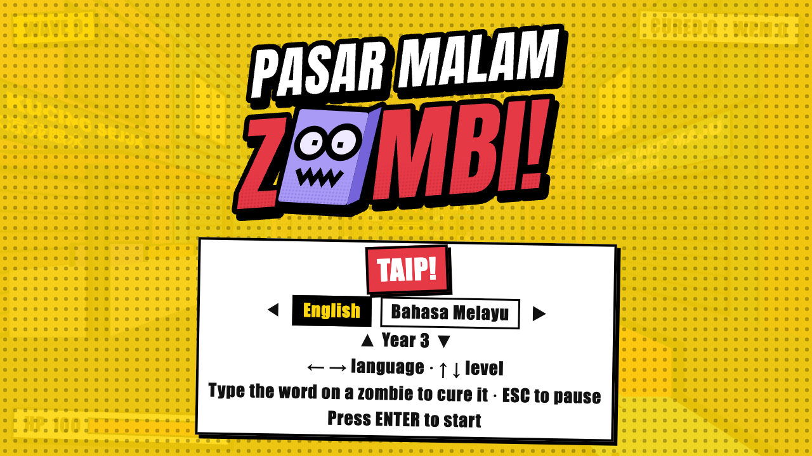
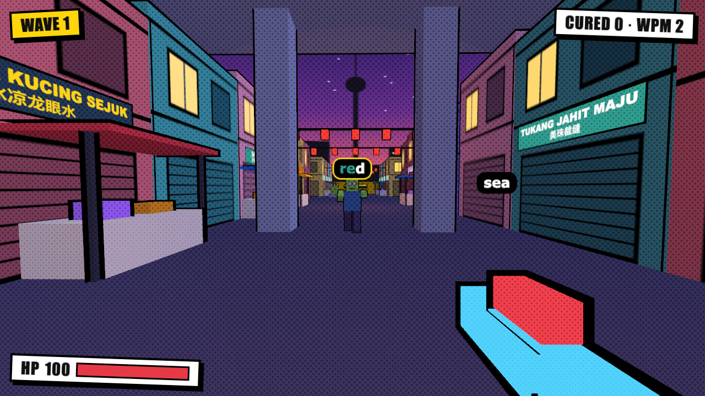
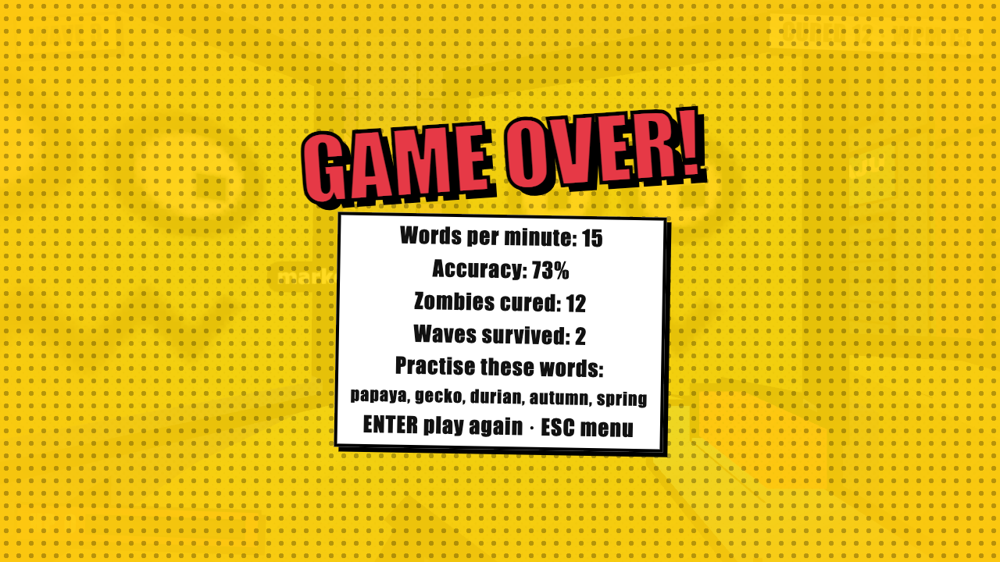

<h1></h1>

**Pasar Malam Zombi! Taip!** is a typing game for Malaysian primary (Darjah 1–6) and secondary (Tingkatan 1–5) students, in English or Bahasa Melayu. Zombies shuffle through a Kuala Lumpur night market, each carrying a word. Type the word exactly and a water pistol cures the zombie. Built with Three.js, TypeScript and Vite.

It is the typing edition of the shooter Pasar Malam Zombi!, with the gun, movement and pickups removed.

| Title | Gameplay | Results |
|---|---|---|
|  |  |  |

## Play

```sh
npm install
npm run dev      # http://localhost:5173
npm run build    # type-check and write a static build to dist/
npm test
```

The game needs a physical keyboard. Phones and tablets get a "needs a keyboard" screen instead of the game.

## Controls

| Where | Key | Action |
|---|---|---|
| Title | <kbd>←</kbd> / <kbd>→</kbd> | Language (English / Bahasa Melayu) |
| Title | <kbd>↑</kbd> / <kbd>↓</kbd> | Level (Darjah 1 to Tingkatan 5) |
| Title | <kbd>Enter</kbd> | Start |
| Play | letters | Type the word on a zombie (case does not matter) |
| Play | <kbd>Esc</kbd> | Pause |
| Paused | <kbd>Enter</kbd> | Resume |
| Results | <kbd>Enter</kbd> | Play again |
| Results | <kbd>Esc</kbd> | Back to the menu |

There is no backspace: a wrong letter counts as a miss. The interface follows the chosen language.

Add `?debug` to the URL for an FPS readout (toggle with <kbd>`</kbd>; <kbd>0</kbd> fills the street with a horde).

## Word lists

Lists live in `words/<en|bm>/<level>.json`, one file per language and level (22 in all). The rules, enforced by `tests/words.test.ts`:

- lowercase a–z only, single words (no spaces, hyphens or apostrophes)
- 70–100 unique words per list
- word length within the level's band (`LENGTHS` in `src/words.ts`):

| Level | Length |
|---|---|
| Darjah 1–2 | 3–5 |
| Darjah 3–4 | 4–7 |
| Darjah 5–6 | 5–9 |
| Tingkatan 1–3 | 6–11 |
| Tingkatan 4–5 | 8–14 |

The lists were drafted with AI and still need review by a teacher before classroom use.
